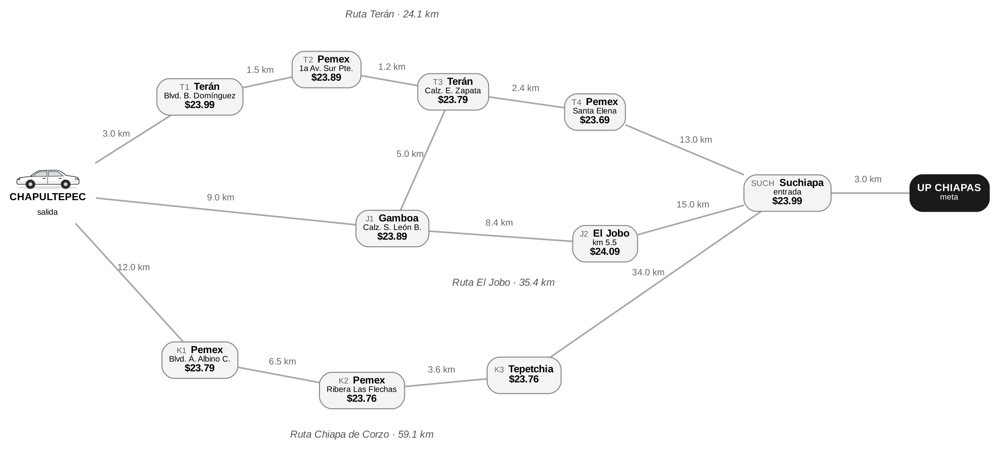
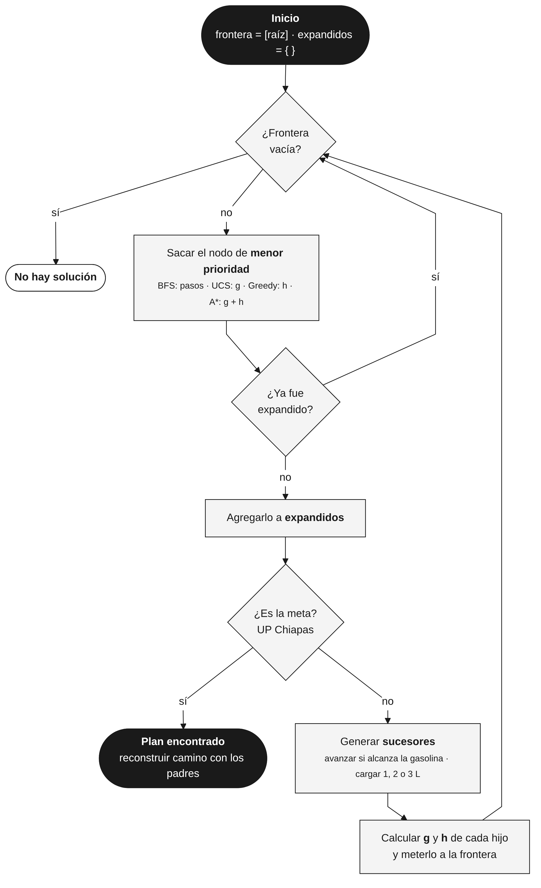
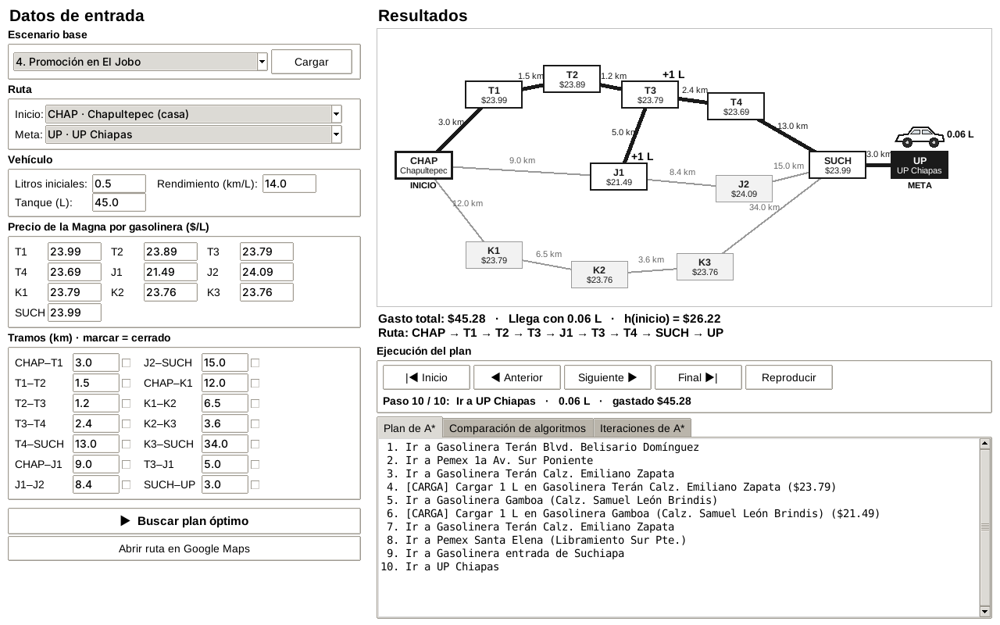
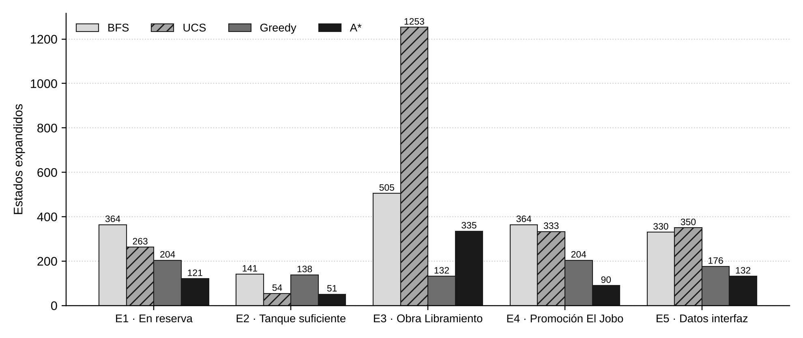
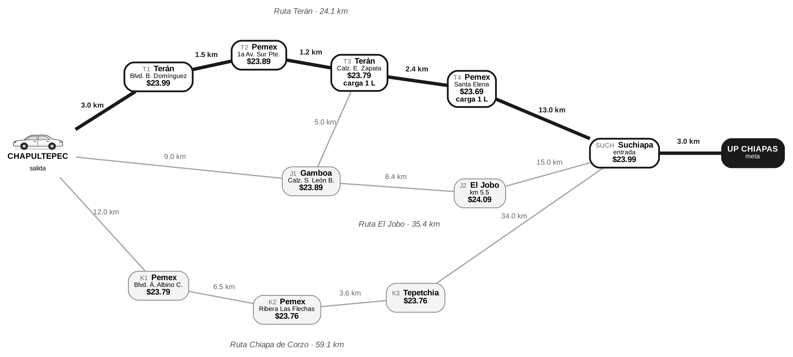
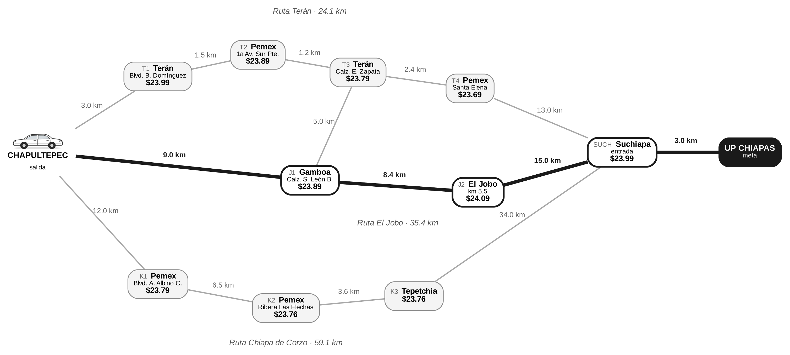
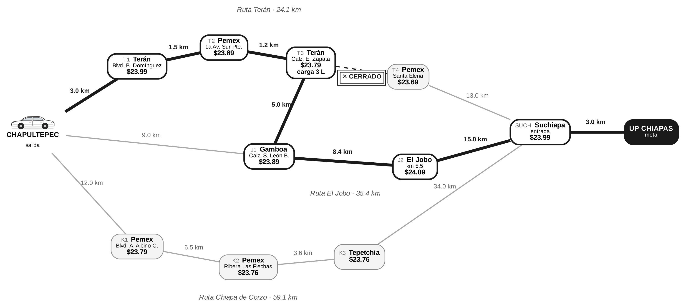
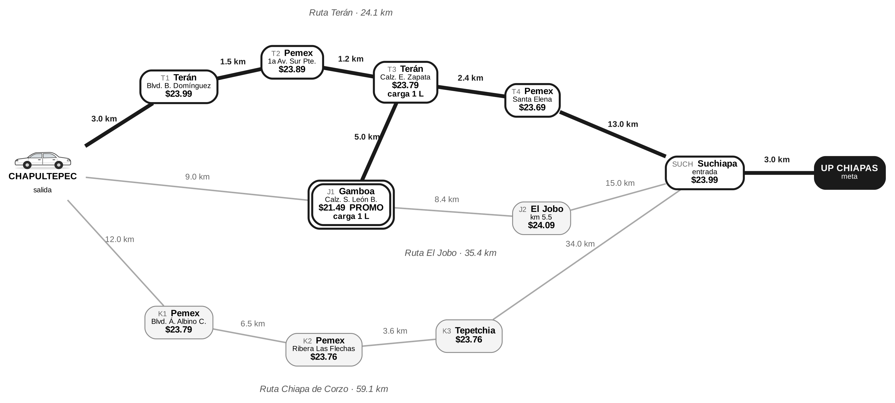

<p align="center"></p>

<h1 align="center">Carga Inteligente</h1>
<p align="center"><b>¿Por dónde ir, dónde cargar gasolina y cuántos litros?</b><br>
Un agente que lo resuelve con <b>búsqueda A*</b> sobre la red vial real Tuxtla Gutiérrez → UP Chiapas.</p>

<p align="center">


</p>

---

## El problema

Salgo de Chapultepec (Tuxtla) a la universidad casi sin gasolina. Hay **3 rutas reales** (Terán 24.1 km, El Jobo 35.4 km, Chiapa de Corzo 59.1 km) y **10 gasolineras** con precios distintos. La gasolinera más barata no siempre se alcanza, y a veces conviene cargar poquito en una y completar en otra.

El agente busca el plan **más barato** sin que el tanque llegue a cero.



## Cómo se modeló

| Elemento | Definición |
|---|---|
| **Estado** | `(lugar, litros_en_tanque)` |
| **Acciones** | `avanzar(vecino)` → $0, gasta km/14 L · `cargar(q)` con q ∈ {1,2,3} → q × precio |
| **Meta** | llegar a UP Chiapas con litros ≥ 0 |
| **Heurística** | `h = max(0, litros_mínimos_a_la_UP − litros) × precio_más_barato` → **admisible** |

Los cuatro algoritmos comparten la misma función de búsqueda; solo cambia la prioridad de la frontera (`pasos`, `g`, `h` o `g + h`).

<p align="center"></p>

## Interfaz gráfica

Con `python interfaz.py` se abre una ventana donde puedes escribir **tus propios datos**: inicio, meta, litros, rendimiento, tanque, precio de cada gasolinera, km de cada tramo y tramos cerrados. Te muestra el mapa con la ruta, la **ejecución paso a paso** del plan, la comparación de algoritmos y las iteraciones de A*.

El método de búsqueda vive en `busqueda.py`, separado de la visualización.



## Vista de exploración

Además de la ruta final, la interfaz tiene una sección para ver **cómo explora la búsqueda**: eliges el algoritmo y con la barra (o el botón **Animar**) recorres **iteración por iteración** qué estado sacó de la frontera, con su `g`, `h` y `f`, y cuántos nodos quedaban pendientes. La pestaña **Frontera (exploración)** muestra los 5 que siguen en la fila.

En el mapa, cada lugar se oscurece según cuántas veces se expandió (`×n`). Así se ve que A* no va en "línea recta": abre varias opciones (cargar o no, cuántos litros, qué tramo tomar) y descarta las caras.

`buscar()` recibe un parámetro opcional `traza` donde guarda cada iteración; la interfaz solo lo lee, el método de búsqueda sigue separado.

## Resultados (5 escenarios)

| Escenario | Plan de A* | Gasto | Expandidos A* / UCS |
|---|---|---|---|
| 1. En reserva (0.5 L) | 1 L en Emiliano Zapata + 1 L en Santa Elena | $47.48 | **121** / 263 |
| 2. Tanque con 5 L | No carga | $0.00 | **51** / 54 |
| 3. Libramiento Sur cerrado | 3 L en Emiliano Zapata y cruza a El Jobo | $71.37 | **335** / 1253 |
| 4. Promoción en Gamboa ($21.49) | Se desvía 5 km para aprovecharla | $45.28 | **90** / 333 |
| 5. Datos escritos en la interfaz | 2 L en Emiliano Zapata | $47.58 | **132** / 350 |

A* siempre encontró el óptimo (igual que UCS) expandiendo **2 a 4 veces menos estados**. BFS y Greedy dieron planes más caros en 4 de 5 escenarios.



<details><summary>Ver la ruta de cada escenario</summary>

**Escenario 1** 
**Escenario 2** 
**Escenario 3** 
**Escenario 4** 
</details>

## Cómo correrlo

```bash
git clone https://github.com/andres-mazariegos/carga-inteligente.git
cd carga-inteligente
pip install -r requirements.txt      # opcional, solo para las gráficas
python carga_inteligente.py          # menú interactivo
python carga_inteligente.py --todos  # corre los 4 escenarios
python interfaz.py                   # interfaz gráfica
```

Al final te da un enlace de **Google Maps** con la ruta y las paradas, y te pregunta si quieres abrirlo.

## Estructura

```
carga-inteligente/
├── busqueda.py               # método de búsqueda (modelo + BFS, UCS, Greedy, A*)
├── interfaz.py               # interfaz gráfica con Tkinter (entradas, mapa, paso a paso)
├── carga_inteligente.py      # modo consola
├── requirements.txt
├── docs/
│   ├── Reporte_Carga_Inteligente.pdf
│   ├── salida_ejemplo.txt
│   └── img/                  # grafo (Graphviz), flujo (Mermaid), gráficas
└── LICENSE
```

## Autores

Proyecto de **Fundamentos de Inteligencia Artificial** — Universidad Politécnica de Chiapas, 7° "C", 2026.

- **Carlos Andrés Mazariegos Laguna** — [@andres-mazariegos](https://github.com/andres-mazariegos)
- **Axel Rodrigo Cuc López** — [@AxelCuc](https://github.com/AxelCuc)
